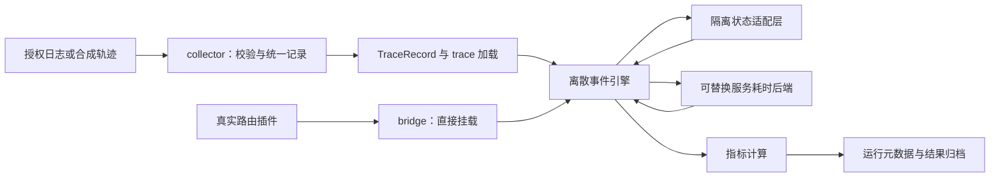

# 轨迹驱动的 LLM 路由仿真平台：设计、实现与验证边界

作者：陶壮

整理日期：2026-11-02

文档范围：`simulator` 模块独立技术报告；适用于学术交流与工程方法介绍。

本文说明如何在同一输入轨迹和受控状态下，调用真实路由插件，比较会话亲和与负载分散策略。平台通过离散事件引擎模拟请求到达、服务完成和集群在途状态，将路由代码与可替换的后端耗时模型解耦。其研究价值在于把“请求选到哪里”“状态是否可比”“性能由什么假设产生”分开检查；工程价值在于减少策略副本维护，并形成采集、校准、实验和结果归档的流程。

本文不披露真实业务轨迹、集群标识、部署规模、内部服务地址或未经独立确认的线上性能点值。报告依据源模块快照 `25f88a3` 和配套设计资料整理；代码路径均相对于原项目根目录。该模块没有复制进本仓库，下面的原平台命令需要原项目及其依赖。本仓库已有的合成模拟继续使用原入口，二者的定位见第 10 节。

## 1. 场景、约束与研究问题

同一个大模型可以由多个后端服务集群承载。入口网关选择集群时，面临两种相互影响的成本：

- 将请求分到较空闲的集群，可以降低等待和拥塞；
- 保持同一会话访问原集群，可能复用前缀缓存，减少重复预填充。

只看累计请求量会忽略请求长短和完成时刻；只看会话亲和比例又会忽略热点会话对少量集群的持续占用。在历史轨迹上直接替换落点，还会产生一个关键问题：新落点上的耗时没有被观测到。

平台围绕三个问题组织实验：

1. **代码一致性**：离线测试是否调用真实插件，而不是另写一份近似算法？
2. **状态一致性**：会话键、可用集群、初始映射和在途状态是否与测试问题对应？
3. **结果可解释性**：回放一致、模型拟合和反事实策略收益，各自能支持什么结论？

平台不执行大模型推理，不建模算子内核，不提供 GPU/NPU 实机性能预测。预填充/解码分离可以作为被调度后端的背景，但本模块的服务模型主要输出请求级耗时，没有逐 token 地模拟 P/D 节点、KV 链路与连续批调度。

## 2. 问题模型与比较口径

### 2.1 请求、状态与决策

令请求序列为

\[
\mathcal R=\{r_i=(a_i,p_i,o_i,g_i,k_i)\}_{i=1}^{M},
\]

其中，\(a_i\) 是到达时刻，\(p_i\)、\(o_i\) 分别是输入和输出 token 数，\(g_i\) 为模型组，\(k_i\) 为路由或会话键。历史记录还可携带实际落点 \(c_i^{\rm obs}\)、端到端耗时 \(d_i^{\rm obs}\) 和首 token 时延 \(f_i^{\rm obs}\)，用于重建与校准。

在时刻 \(t\)，引擎维护各集群在途数 \(n_c(t)\)。路由插件根据请求和可见状态选取目标

\[
c_i=\pi(r_i,\widehat{\boldsymbol n}(t),\mathcal H(t),\mathcal S(t)),
\]

其中 \(\mathcal H(t)\) 是候选部署，\(\mathcal S(t)\) 是会话映射。当前主路径在派发前把引擎持有的在途状态写入适配层；这通常是理想化的即时视图，不应默认等于线上带刷新时滞的观测。

后端通过统一接口返回

\[
(d_i,f_i)=B(p_i,o_i,n_{c_i}(t),h_i,c_i;\theta,\xi_i),
\]

其中 \(h_i\) 为模型假定的缓存命中，\(\theta\) 是耗时模型参数，\(\xi_i\) 是随机源。完成时刻为 \(e_i=t_i+d_i/1000\)。请求派发后在途加一，完成事件发生后减一。

**公平比较需要同时固定输入、资源、状态协议和后端假设。** 同一个随机种子并不自动意味着不同策略经历逐请求相同的随机样本；当前分支的调用次数可能不同，策略差异和采样差异仍需用多种子、配对设计和敏感性检查区分。

### 2.2 核心目标

平台不把最小在途数、最大亲和比例或某个单次吞吐值直接当作最终目标，而是联合观察：

- 请求吞吐与 TTFT 的中位数、尾部分位；
- 请求拒绝、路由异常和未选出部署的情况；
- 集群间瞬时负载离散程度；
- 会话复用与缓存收益的建模敏感性。

如需声明策略改善，应说明它在什么工作负载、并发水位、缓存假设和后端模型下改善了哪项指标，同时保留退化场景。

## 3. 采集、插件与引擎的解耦架构



| 模块 | 责任 | 设计意义 |
| --- | --- | --- |
| `simulator/collector/schema.py` | 定义、校验和序列化 `TraceRecord` | 采集与实验共享一份数据契约。 |
| `simulator/collector/sources/` | CSV、应用日志、数据库日志、监控及对象归档等来源适配 | 增加数据源时不改变路由引擎。 |
| `simulator/trace.py` | 读取轨迹，构造部署列表与插件输入结构 | 会话键与字段位置成为可检查的接口。 |
| `simulator/bridge.py` | 按运行目录直接导入插件并发现 handler | 减少离线算法副本与生产代码漂移。 |
| `simulator/redis_shim.py` | 给插件提供其所需的状态读写接口 | 状态存储与路由决策分离。 |
| `simulator/engine.py` | 推进时钟、派发请求、处理完成事件 | 统一两种实验模式。 |
| `simulator/core/backend.py`、`core/backends/` | 定义服务接口，提供参数化及经验后端 | 引擎不依赖特定耗时公式。 |
| `simulator/calibrate.py` | 重建历史在途，评价状态对决策的解释力 | 避免只看性能表而忽略状态失真。 |
| `simulator/benchmark.py`、`cli.py` | 多策略、多种子与配置编排 | 形成可重复执行的实验流程。 |
| `simulator/metrics.py`、`storage/results.py` | 计算指标，保存运行元数据与结果 | 让比较条件和代码版本可追查。 |

### 3.1 数据契约

必填字段为请求标识、到达时间、输入 token 数、输出 token 数、端到端耗时和模型组。实际落点、TTFT、用户键、会话键及来源元信息为可选字段。缺少可选字段会缩小可验证范围：没有实际落点就无法计算落点一致率，没有逐请求 TTFT 就不能独立验证 TTFT 分布。

字段名相同也不一定代表业务语义相同。采集器须保留真实路由键的完整语义，不能把某个嵌套设备字段擅自替换成用户或会话键。模型别名共享资源时，还需按实际资源池补齐背景流量，否则重建的在途数可能系统性偏低。

监控时序可以补充负载信息，但聚合指标通常不能恢复逐请求的会话与落点；接入了一个数据源，不代表它已经能提供完整轨迹。

### 3.2 真实插件直接挂载

`bridge.py` 构造 `callbacks` 包，并把其 `__path__` 指向源项目的路由及相关回调目录。插件仍使用原模块和 handler；配置中的 callback 条目用于发现待测对象。挂载过程计算模块文件指纹，辅助追踪代码版本。

这项机制的含义是**不通过复制源码维护另一套路由实现**。它不意味着把插件导入成功后即可认为链路正确：插件依赖的缓存、环境变量、输入字段和 hook 调用顺序仍须满足。`bootstrap.py` 通过带会话的探针请求检查插件是否真正返回单一目标，防止插件旁路后引擎机械取列表首项，产生看似完整的错误结果。

自动发现也只解决导入和 handler 定位，不能自动验证新插件的全部外部依赖与语义。

## 4. 两种实验模式及时间缩放

### 4.1 开环回放：到达过程由输入给定

回放模式按轨迹到达时刻派发请求。对每条请求，先释放已完成事件，再构造插件输入、同步在途状态、调用插件、计算服务耗时并将完成事件入堆。采用最小堆维护事件，处理 \(M\) 个请求的事件操作通常为 \(O(M\log M)\)；这不包含插件自身的排序、状态 I/O 或经验池拟合开销。

引擎支持到达缩放 \(s_a\) 和服务缩放 \(s_d\)：

\[
t_i'=t_0+(a_i-a_0)/s_a,\qquad d_i'=d_i/s_d.
\]

两者相同是在模型内同步压缩时间；只压缩到达而保持服务时长，则提高了相对供给的到达压力。它们回答不同问题，不能混用。路由缓存中依赖墙钟的 TTL 也不一定随模拟时钟同步缩放。

回放适合检查输入、状态和路由行为，并分析给定到达压力下的时延。有限轨迹的实际完成率采用排空跨度，仍会受到尾部排空和拒绝影响；在长窗口且全部处理完成时，它往往接近外生到达率，**不宜直接用它给策略的服务容量排名**。

### 4.2 闭环容量：完成事件驱动补位

容量模式在开始时填入目标并发水位 \(K\)，随后每完成一条就从输入序列中补一条，直到请求用尽。模式内不再使用原始到达间隔构成开放流量压力，而是保留请求的组成与顺序。

在服务模型和无拒绝等条件成立时，完成请求数除以总模拟时间可描述该水位下的闭环吞吐。它是**指定模型与并发水位下的完成率**，不是生产峰值，也不是无需水位扫描即可得到的容量上限。

关键实现是：容量模式不向经验后端传入历史实际落点与实际耗时，强制所有策略走同一类反事实采样路径。否则，高落点重合的策略可以直接使用真实耗时，其他策略却使用估测耗时，比较条件会不对称。

当前容量分支在插件返回空列表时直接跳过，未像回放分支一样完整记录拒绝结果。因此本分支主要适用于保证产生可用目标的插件；评价拒绝策略时应先补齐统计与补位语义，不能把漏记请求后的指标作为可靠拒绝率。

## 5. 可替换的服务耗时后端

### 5.1 参数化后端

参数化后端根据输入/输出规模、预填充和解码成本、在途放大及缓存折扣计算耗时；TTFT 还可通过输入长度分桶表估计。它便于解释变量作用和做敏感性分析，但负载放大系数、缓存折扣和抖动范围未必能由现有轨迹唯一辨识。

如果实测服务时间已经包含排队，再乘一次负载放大，可能重复计算拥塞。应区分“从数据拟合得到的参数”“人为选择的情景参数”和“尚未辨识的参数”。本报告不把默认值当作实测模型参数。

### 5.2 经验后端的三条路径

| 路径 | 条件与处理 | 可用于什么 |
| --- | --- | --- |
| 观测值复用 | 选中集群与历史落点相同且实测耗时有效，直接使用记录值 | 条件回放与链路检查。 |
| 经验采样 | 无可复用观测值时，从参考集群的条件经验池抽样，并按当前在途校正 | 依赖模型假设的策略比较。 |
| 参数化回落 | 没有可用参考样本 | 保持接口运行，必须单独识别其覆盖比例。 |

经验池根据 prompt 长度和在途水平分桶。样本充足的参考集群使用自身分布；弱样本或新集群借用参考池。为避免把“历史繁忙集群上的慢响应”原样赋给当前空闲集群，后端拟合在途到耗时的曲线，并做比例校正：

\[
\widetilde d=d_{\rm sample}\,
\operatorname{clip}\left(\frac{m(n_{\rm now})}{m(n_{\rm sample})},\ell,1/\ell\right),
\qquad m(n)=a+bn.
\]

TTFT 有独立的校正曲线。代码使用在途桶的均值拟合趋势，故拟合优度是**桶均值层面**的指标，不能解释为逐请求预测准确度或异地落点的因果效果。超过观测负载范围时，线性外推与缩放截断都是额外假设。

经验采样路径主要按输入长度和在途条件选样，未以输出 token 数独立条件化；尽管接口接受输出长度，也不能据此声称已完整建模不同输出长度下的解码差异。缺失 TTFT 时的比例估算和会话缓存折扣同样需要单独标注。

### 5.3 条件回放与独立预测必须分开

`prewarm` 可以根据轨迹首条落点初始化会话映射；`exact_replay` 则在每条请求派发前，把该请求已知的实际落点写入亲和映射。对于读取该映射的插件，它会主动提高落点一致率；随后经验后端又可直接复用该请求的观测耗时。

这是一种**带标签的条件回放**，适合验证字段、状态恢复和结果管线。落点接近一致、TTFT 分布接近原数据，不能单独证明路由预测准确或新策略收益可信。尤其不能把同一批已知落点既作为输入，又把落点一致当作独立验证。

独立验证应关闭逐请求落点注入，在独立时间窗口检验未见数据，并对新落点的服务模型另作留出验证。所有策略共享一个后端可以减少比较条件差异，但策略会进入不同负载和缓存区域，模型误差可能不同向，**共享后端不能保证策略排名正确**。

## 6. 策略集合与可解释亲和判据

现有基线包括随机、逐请求轮询、会话哈希、带亲和的轮询、低负载候选选择，以及可选的原生路由策略适配。基线与真实插件使用同一 `async_filter_deployments` 签名，降低调用路径差异。

`sticky_aware` 是平台内的亲和感知候选基线。设原绑定集群在途为 \(n_p\)，全局最小在途为 \(n_{\min}\)，则保留亲和的判据为

\[
n_p\leq\max(r\,n_{\min},n_{\min}+s).
\]

其中 \(r\) 是相对容忍比例，\(s\) 是低负载时的绝对容忍量。超出阈值后，从最空闲的

\[
q=\max(1,\lceil\eta N\rceil)
\]

个集群中随机选择，\(\eta\) 为候选比例。候选比例、\(r\)、\(s\) 都是可扫描参数。

该判据有工程可解释性，便于检查会话是否因旧映射持续压在热点上；但它只是以在途数近似等待成本的启发式。它不等同于根据真实双端缓存与等待时间建立的完整时延最优化，也未证明存在通用最优参数。平台基线中某个参数组合的实验表现，不能写成线上插件已经采用或已带来业务收益。

## 7. 指标定义及实现边界

| 指标 | 当前计算或解释 | 阅读注意事项 |
| --- | --- | --- |
| 完成率 TPS | 选中请求数 / 首请求至排空的跨度，按记录的时间尺度换算 | 不是 token/s；拒绝、排空和模式都会改变解释。 |
| TTFT P50/P95/P99 | 从后端返回的首 token 时延排序取分位 | 是模型输出；分位采用当前代码的下标规则，无插值。 |
| E2E 分位 | 后端返回端到端耗时的分位 | 不是逐 token 的真实执行测量。 |
| 瞬时在途 CV | 对采样快照求集群间标准差/均值，再平均 | 当前为样本平均，非按时间间隔加权；两种模式采样方式不同。 |
| 分配 CV | 对累计分配到各集群的请求数求离散度 | 不等于实时忙闲程度。 |
| 会话命中比例 | 有上一跳且同目标、缓存记忆未过期的比例 | 模型用其近似 APC 命中，不能称为设备侧实际缓存命中率。 |
| 估计预填充节省 | 无缓存模型 TTFT 与有缓存模型 TTFT 的差 | 是模型差分，不是实测节省；随机采样还会引入差分噪声。 |
| 落点一致率 | 有历史落点且选出目标的请求中，模拟与历史落点相同的比例 | 必须同时报告预热及 `exact_replay` 是否启用。 |

会话路由 TTL 与前缀 KV 驻留时间是两个物理量。前者是网关映射的生命周期，后者受后端缓存容量、淘汰和请求前缀影响。`state/sticky.py` 用带抖动的会话记忆近似后者，尚未模拟真实 KV 块分配和逐前缀淘汰。

真实 Redis 模式与进程内模式也有不同边界。内存适配层减少了往返和批量状态同步开销，但当前不执行 Redis TTL 过期，Lua `eval` 也未实现。它适合短程、单线程、适用插件下的策略扫描，不能作为 Lua 原子性、分布式竞争或跨 TTL 行为的等价验证。真实 Redis 的键过期若基于墙钟，同样需要检查其与快速推进模拟时钟的差异。

此外，当前回放收尾阶段的快照处理并非完整的逐事件负载重建。因此，不宜直接依赖其收尾快照均值进行精细 CV 推断；需要这类结论时，应从逐请求派发/完成事件重新计算按时间加权的负载统计。

## 8. 已验证事实与后续实验矩阵

### 8.1 本轮可公开核验的结果

2026-11-02 在本地读取源代码并运行现有纯合成校准自检：

```bash
python -B -m simulator calibrate-selftest
```

该命令不需要业务 trace、外部 Redis 或推理设备。四种已知答案的场景全部返回预期分类：

| 合成场景 | 预期 | 实际 |
| --- | --- | --- |
| 路由选择低负载候选 | `informative` | 通过 |
| 路由选择与负载无关 | `no_signal` | 通过 |
| 路由偏向最忙集群 | `below_chance` | 通过 |
| 全部集群在途相同，候选退化为全集 | `degenerate` | 通过 |

**4/4 通过说明该校准分类器在四种构造场景中能按预期工作。** 它不证明经验后端在真实流量上的预测误差，也不证明某个路由策略优于其他策略。本轮没有重新执行内部轨迹性能实验，没有将既有总结中的内部绝对值或相对收益转作公开性能结论。

### 8.2 可继续执行的验证矩阵

| 要验证的对象 | 方法 | 需要保存的证据 |
| --- | --- | --- |
| 插件真正参与决策 | 不对称负载探针，检查 handler 与返回部署数量 | 插件版本、指纹、输入、返回值、失败原因。 |
| 事件推进与守恒 | 固定服务时长微场景，检查在途加减及完成顺序 | 逐请求起止时刻与按时刻在途。 |
| 初始状态恢复 | 冷启动、仅窗口前状态预热、逐请求标签注入分列 | 每种状态来源与路由分支占比。 |
| 服务模型泛化 | 按时间切分训练与留出，关闭观测值复用 | 负载覆盖、分位误差、弱样本与回落占比。 |
| 容量随水位变化 | 扫描 \(K\)，同时报告吞吐、尾延迟及拒绝 | 每个水位、策略、种子的完整结果。 |
| 缓存假设敏感性 | 扫描折扣与保留时间，增加失效/淘汰场景 | 参数范围、排名稳定性与退化场景。 |
| 状态时滞鲁棒性 | 对比即时真相、周期刷新及扰动状态 | 刷新周期、偏差模型和策略退化。 |
| 异构与弱样本集群 | 区分服务能力，留出部分集群 | 参考池选择、跨集群迁移假设及误差。 |
| agent 任务级效果 | 增加任务、轮次、工具事件和依赖链 | 任务成功率、总耗时与 token/工具成本。 |

agent 多轮任务可以产生重复请求与会话局部性，因此是后续场景之一。当前平台消费的是模型请求轨迹，不应把已有请求级实验宣称为某个 agent 或工具任务基准的实测结果。

## 9. 个人贡献与可追溯演进

本模块作为陶壮的独立工程工作介绍。源仓库中可核验的相关提交覆盖架构、数据链路、模型与验证迭代；下面选取设计决策对应的代表性记录，不以代码行数代替贡献说明。

| 本人承担的问题 | 设计或实现决策 | 代表性源提交 | 作用与边界 |
| --- | --- | --- | --- |
| 路由算法离线副本容易漂移 | 调整独立模块结构，真实插件直接接入，统一 CLI 与配置 | `f7c0f7f`、`3cfd056` | 平台与网关插件分离演进；不表示重写了整个网关。 |
| 插件看似加载但实际未选点 | 修复调用链并加入输入/分支检查 | `b0ab80b` | 提高实验的接口有效性。 |
| 耗时模型与会话语义混杂 | 拆分 Backend，区分路由 TTL 与缓存驻留 | `bcc853f`、`7aa3025`、`4f39842` | 明确模型边界，便于替换与校准。 |
| 采集不足以解释历史行为 | 增加日志采集源，改进路由键和背景流量口径 | `3925b61`、`922f779` | 建立数据到状态的核验链；聚合源仍有信息损失。 |
| 时间尺度导致吞吐口径错误 | 统一排空时间轴与服务/到达缩放 | `6ea4fb2`、`922f779` | 修复可比较性问题，未因此形成线上收益声明。 |
| 反事实估测偏向历史繁忙集群 | 引入经验后端，使用参考池和在途校正 | `383b15f` | 改善模型组织；仍需留出验证与敏感性分析。 |
| 单纯亲和或均衡难兼顾 | 增加亲和感知候选及同插件状态消融 | `427489b` | 提供可解释研究基线，不等于生产已启用。 |
| 状态往返限制规模扫描 | 批量读写、变化集群同步和进程内模式 | `3dbf350` | 降低实验执行开销；不能省略内存模式语义限制。 |
| 重复代码影响维护 | 公共基线逻辑抽取与检查问题修复 | `99d7544`、`25f88a3` | 改善实现维护性，不作为性能指标。 |

上述归因限定在可核验的 simulator 模块和对应修改。LiteLLM 上游能力、团队网关、团队模型服务和实际部署结果不全部归为个人成果；既有请求路由算法的协作归属也不因本报告而改变。

## 10. 两套模拟的关系与复现入口

### 10.1 本仓库的合成复现

本仓库 `llm-scheduling-repro` 使用 `src/llm_repro/routing.py` 和 `eplb.py`，在明确的合成请求和参数下复现请求路由与专家部署问题。它具有显式 P 等待、KV 传输、D 批处理或单层专家模型，与真实插件挂载平台属于不同实现。

| 维度 | 本文的 simulator 平台 | 本仓库合成复现 |
| --- | --- | --- |
| 主要对象 | 插件行为、状态恢复和轨迹驱动策略比较 | 报告模型、合成场景与算法机理。 |
| 路由实现 | 挂载真实插件，也可接同接口基线 | 复现模型内实现。 |
| 输入 | 经授权轨迹或兼容合成轨迹 | 公开可生成的合成请求。 |
| 服务耗时 | 参数化、经验采样或条件观测值复用 | 显式资源与时间模型。 |
| 可运行位置 | 原项目及其依赖 | 当前仓库。 |
| 数字含义 | 对应特定模式、状态和后端假设 | 合成负载下的模型结果。 |

在当前仓库运行：

```bash
python -m unittest discover -s tests -v
python scripts/run_experiments.py --quick --out results/local/quick
```

已有方法、场景和原始结果见[算法与场景报告](ALGORITHMS_SCENARIOS_REPORT.md)、[模型定义](MODEL.md)和[参考结果](../results/reference/RESULTS.md)。这些合成结果不能替代 simulator 的真实插件接口验证，也不能还原真实硬件点值。

### 10.2 原平台的受控复现

原平台需要匹配版本的 LiteLLM/网关插件、Python 依赖、轨迹和隔离状态适配层。可先执行纯合成校准自检，再根据具备的输入选择模式。以下仅演示参数形式，使用无业务含义的 `public_model` 和经授权的 `sanitized_trace.csv`，不引用内部预设配置：

```bash
# 在原项目根目录；需要匹配依赖，不依赖业务数据的自检
python -B -m simulator calibrate-selftest

# 合法脱敏轨迹上的开环；默认不启用逐请求落点注入
python -m simulator compare --model-group public_model --trace sanitized_trace.csv --mode replay --backend empirical --seeds 5 --arrival-scale 1 --service-scale 1 --notes public_replay

# 闭环容量；K=32 是演示水位，应扫描更多水位
python -m simulator compare --model-group public_model --trace sanitized_trace.csv --mode capacity --backend empirical --concurrency 32 --seeds 5 --notes public_capacity
```

`--trace` 是加载回退入口，若 collector store 已有匹配模型组的数据，可能优先读 store；实验前须使用隔离目录并确认加载日志和实际记录摘要。插件实验使用专用 Redis；内存模式只用于其语义适用的场景，不连接生产状态存储。新环境应锁定依赖版本，不能仅凭命令行参数一致就宣称复现完成。

原平台会保存 `meta.json`、`benchmark.json` 和运行索引，但当前元数据结构没有完整覆盖所有经验后端参数、消融覆盖项与数据哈希。严谨复现还应保存脱敏输入哈希、完整解析配置、插件/引擎版本、依赖锁、后端拟合与回落诊断，以及每个种子的逐请求记录。上述是补充要求，不能写成现有归档已经全部具备。

## 11. 限制与结论

该平台把真实插件调用、轨迹状态恢复、后端耗时估测和指标归档组织为可检查的流程。可确认的个人工作在于建立并迭代这套实验基础设施，解决插件旁路、时间尺度、路由键、弱样本估测和状态开销等具体工程问题，并把亲和与均衡的策略比较变成可重复的实验。

平台当前适合接口回归、条件回放、策略候选筛选和建模敏感性研究。它仍依赖缓存近似、经验池覆盖和观测状态假设；内存状态语义、容量拒绝统计、反事实耗时泛化及结果归档完整性也有明确改进空间。学术交流时应把“实现了什么”“本轮验证了什么”和“仍需外部验证的收益”分别表达。

本文没有给出未经披露确认的线上点值，也没有据条件回放声称普遍保真。后续最有价值的证据，是在关闭标签注入、使用独立留出与受控实机对照后，验证策略在不同负载、缓存条件及任务类型下的收益与退化范围。
